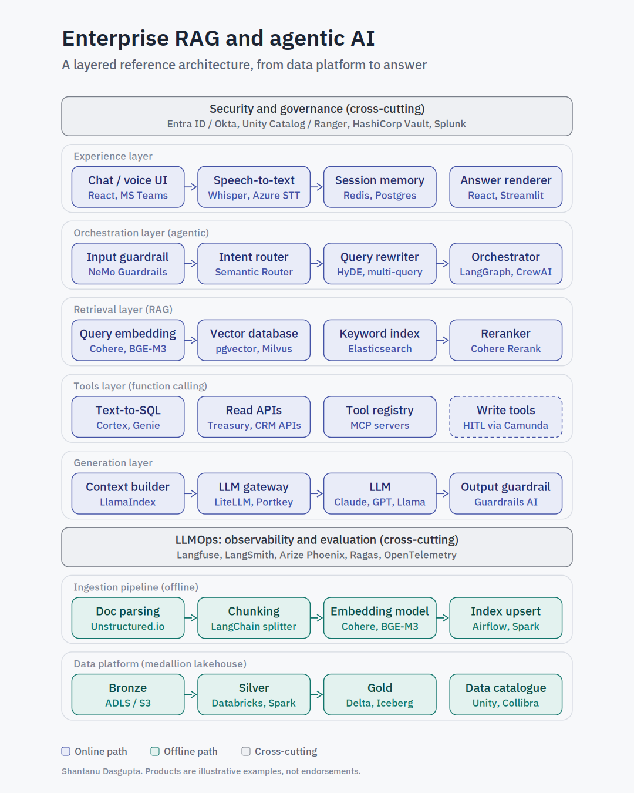

# Enterprise RAG and agentic AI reference architecture

An interactive, layered reference architecture for enterprise retrieval-augmented generation (RAG) and agentic AI, written with banking and treasury use cases in mind.

**Live page:** https://shantanujbp-ai.github.io/ai-portfolio/rag-agentic-architecture/

## What it shows

Seven layers on two paths, wrapped by two cross-cutting layers:

| # | Layer | Key components |
|---|---|---|
| 1 | Experience | Chat / voice UI, speech-to-text, session memory, answer renderer |
| 2 | Orchestration (agentic) | Input guardrail, intent router, query rewriter, orchestrator |
| 3 | Retrieval (RAG) | Query embedding, vector database, keyword index (BM25), reranker |
| 4 | Tools (function calling) | Text-to-SQL, read APIs, tool registry (MCP), write tools with human-in-the-loop |
| 5 | Generation | Context builder, LLM gateway, LLM, output guardrail |
| 6 | Ingestion pipeline (offline) | Document parsing, chunking, embedding model, index upsert |
| 7 | Data platform | Bronze, Silver, Gold (medallion lakehouse), data catalogue |
| 8 | Cross-cutting | Security and governance; LLMOps observability and evaluation |

## Four scenarios

1. **Policy question (RAG):** hybrid retrieval with entitlement filtering, reranking and grounded, cited answers.
2. **Numeric query (Text-to-SQL):** figures come from curated Gold tables, never from the vector store.
3. **Write action (HITL):** state-changing tools are gated by human approval and a full audit trail.
4. **Ingestion run:** how documents and structured data reach the indexes and Gold tables.

## Design principles

1. Separate the offline ingestion path from the online query path.
2. Enforce access control inside retrieval, not as a gate in front of it.
3. Route numbers to structured tools, not to embeddings.
4. Put guardrails on both input and output.
5. Never let an agent execute a write action without human approval.
6. Use the same embedding model for ingestion and queries.

## Notes

Products named are illustrative examples, not endorsements, and the tooling landscape changes quickly. Scenarios are generic and do not depict any institution's systems.

Created by Shantanu Dasgupta as personal work for learning and discussion. Views are my own.
